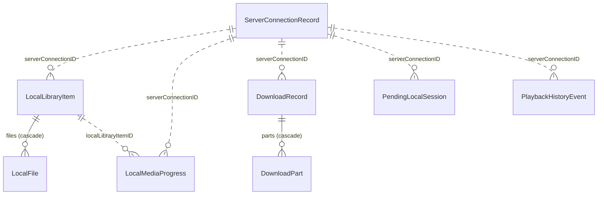

# 0003. SwiftData schema, versioning and actor boundaries

- Status: Accepted
- Date: 2026-11-09
- Issue: #35 (P1-12)

## Context

The server owns almost everything: libraries, items, progress, bookmarks, users and
listening sessions. The device only has to keep what the server can't give back
when it is unreachable, plus the local bookkeeping for downloads:

- saved server connections;
- downloaded items, their files and enough metadata to play them offline;
- progress made on this device that the server hasn't seen yet (audio and ebook);
- playback sessions recorded offline, waiting for `POST /api/session/local-all`;
- background download state, including a reference to encrypted resume data;
- the per-item playback history shown by `pages/media/_id/history.vue`.

The legacy iOS app keeps all of this, and more, in Realm (schema version 21,
`ios/App/App/AppDelegate.swift`). Its models mix concerns: tokens are stored in
`ServerConnectionConfig`, `DownloadItemPart.uri` stores a download URL with the
token in the query string, file locations are resolved against `Documents`, and
playback sessions embed whole `LibraryItem` objects. Nothing is migrated from that
store, because the server holds progress
([ADR 0002](0002-identity-and-no-migration.md)), but its behaviour is the porting
reference.

Constraints:

- Swift 6 language mode with complete strict concurrency checking; minimum OS
  iOS/iPadOS/macOS 27.0; persistence lives in the `ABSData` module
  ([ADR 0001](0001-architecture.md)).
- [ADR 0001](0001-architecture.md) already says services are actors, only
  `Sendable` DTOs cross actors and `@Model` objects never do.
- Widgets (Phase 5) read the store from another process, so it lives in the App
  Group `group.org.davidjensenius.Audiobookshelf` (#18, P0-03).
- Tests run with `swift test` on macOS, unsigned, without an App Group entitlement.
- The SwiftData facts used here come from
  [platform-apis.md §4.1](../research/platform-apis.md#41-swiftdata-maturity-on-27-swiftinterface-1483-lines)
  and were re-checked against the Xcode 27.2 SDK `SwiftData.swiftinterface` (macOS
  and iOS are identical for every API below) and in a throwaway Swift 6 spike (see
  [Validation](#validation)).

## Decision drivers

1. **Correct offline progress.** Progress made offline is never lost and is synced
   exactly once.
2. **Compiler-checked concurrency.** Swift 6 must reject any `@Model` or
   `ModelContext` crossing an isolation boundary.
3. **Safe evolution.** Every shipped store opens after an app update; schema
   changes are explicit and tested.
4. **Small surface.** Persist only what the server can't provide; no second copy of
   the server database.
5. **Testable** with in-memory containers and `swift test`.
6. **Built-in frameworks only.**

## Options considered

### Option 1: SwiftData with a versioned schema and `@ModelActor` stores that exchange DTOs (chosen)

All models live in `SchemaV1` (a `VersionedSchema`) with a `SchemaMigrationPlan`.
All writes go through `@ModelActor` stores in `ABSData` whose public API takes and
returns `Sendable` value types and `PersistentIdentifier`s. Views may read with
`@Query`; view models observe with `ResultsObserver` or `HistoryObserver`.

- Pros:
  - Built in, works on iOS and macOS, and integrates with SwiftUI (`@Query`) and
    Observation.
  - The SDK makes `@Model` and `ModelContext` non-`Sendable`, so leaks across
    actors are compile errors (verified).
  - `#Unique`, `#Index`, `.externalStorage`, `.codable`, cascade deletes, history
    and App Group configuration cover every requirement without custom SQL.
  - Background writes don't block the main actor.
- Cons:
  - DTO mapping boilerplate for every model.
  - Migration failures surface only when the container loads, so every version
    needs a test.
  - `#Unique` does not deduplicate rows whose key contains `nil` (verified), so
    key fields must be non-optional.

### Option 2: SwiftData used directly on the main actor

Views and view models fetch and mutate `@Model` objects through `mainContext`; no
stores.

- Pros:
  - Least code; `@Query` everywhere.
- Cons:
  - Download delegate callbacks, playback progress and sync run off the main actor
    and would hop to it for every write.
  - Business rules (upsert, pending sync, merge) spread across views and can't be
    tested without SwiftUI.
  - Conflicts with ADR 0001 (services are actors).

### Option 3: Core Data or SQLite (GRDB)

Use `NSPersistentContainer` with a model file, or a third-party SQLite wrapper.

- Pros:
  - Mature migration tooling; GRDB gives full SQL control and value-type records.
- Cons:
  - Swift 6 does not check `NSManagedObject` isolation the way it checks
    `@ModelActor`, and the model file is another artifact to keep in sync.
  - GRDB is a new SPM dependency, which AGENTS.md rules out when a built-in
    framework is enough.

### Option 4: Codable files and `UserDefaults`

Write JSON files for downloads and progress, and `UserDefaults` for connections.

- Pros:
  - No framework; trivially `Sendable`.
- Cons:
  - No queries, indexes, uniqueness or atomic multi-record updates; every reader
    loads everything.
  - Consistency across processes (widgets) and change notification are hand-rolled.

## Decision

Use **Option 1**. The rules below are the contract for #36 (P1-13a) (schema and
`DataStack`) and #37 (P1-13b) (stores); deviating from them needs a new ADR.

### Entities (SchemaV1)

Solid lines are SwiftData relationships; dotted lines are scalar keys.
**Relationships are used only inside an aggregate** (item → files, download →
parts). References between aggregates are scalar keys, so removing a server
connection or deleting a download never cascades into progress or history.

General rules:

- Every model has a primary key in a `#Unique`: `id`, or `key` for
  `LocalMediaProgress`.
- Fields in a `#Unique` are **never optional**, because `#Unique` treats `nil` as
  distinct. Where the natural key has an optional part (the episode), the model
  stores a derived `key: String`.
- The **media key** is
  `"\(serverConnectionID.uuidString)|\(libraryItemId)|\(episodeId ?? "")"`, built
  by one `MediaKey` helper in `ABSData`.
- Enumerations are stored as raw `String` values with a typed computed accessor, so
  predicates stay simple.
- Instants are `Date`; media positions and durations are `Double` seconds.
  Conversion from and to the server's millisecond timestamps happens in the API
  layer.
- File locations are **relative paths** (`String`) under the downloads root
  (`URL.applicationSupportDirectory/Downloads/` in the app container), resolved at
  runtime. Never store absolute paths, `file://` URLs or tokens.

| Model | Key | Other fields | Uniqueness and indexes |
| --- | --- | --- | --- |
| `ServerConnectionRecord` | `id: UUID` | `address` (normalized base URL with subpath, no trailing `/`), `userId`, `username`, `authMethod` (`local`/`openid`), `serverVersion: String?`, `createdAt`, `lastUsedAt: Date?`, `isDisconnected: Bool`, `disconnectedAt: Date?` | `#Unique([\.id], [\.address, \.userId])`; `#Index([\.lastUsedAt])` |
| `LocalLibraryItem` | `id: UUID` | `serverConnectionID: UUID`, `serverAddress`, `serverUserId`, `libraryItemId`, `mediaType` (`book`/`podcast`), `title`, `authorName: String?`, `relativeDirectory`, `coverRelativePath: String?`, `coverUpdatedAt: Date?`, `addedAt`, `updatedAt`, `@Attribute(.codable) media: LocalMediaSnapshot`, `@Relationship(deleteRule: .cascade) files: [LocalFile]` | `#Unique([\.id], [\.serverConnectionID, \.libraryItemId])`; `#Index([\.libraryItemId], [\.serverConnectionID])` |
| `LocalFile` | `id: UUID` | `item: LocalLibraryItem?` (inverse), `kind` (`audio`/`ebook`), `relativePath`, `filename`, `mimeType`, `size: Int64`, `serverIno: String?`, `trackIndex: Int?` (book track order), `episodeId: String?` (podcast) | `#Unique([\.id])` |
| `LocalMediaProgress` | `key: String` (media key) | `serverConnectionID: UUID`, `libraryItemId`, `episodeId: String?`, `localLibraryItemID: UUID?`, `duration`, `progress`, `currentTime`, `isFinished`, `ebookLocation: String?`, `ebookProgress: Double?`, `startedAt: Date?`, `finishedAt: Date?`, `lastUpdate: Date` (latest change, for display and ordering only), `audioDirty: Bool`, `finishedDirty: Bool`, `ebookDirty: Bool`, `audioEditedAt: Date?`, `finishedEditedAt: Date?`, `ebookEditedAt: Date?`, `@Attribute(.codable) serverBaseline: ProgressBaseline?`, `@Attribute(.codable) unacknowledgedSends: [ProgressSend]` (oldest first, at most 8), `audioHistoryTruncated: Bool`, `finishedHistoryTruncated: Bool`, `ebookHistoryTruncated: Bool` (all default `false`), `needsServerSync: Bool` (true when any dirty flag is set), `lastSyncAttemptAt: Date?`, `lastSyncError: String?` | `#Unique([\.key])`; `#Index([\.needsServerSync], [\.serverConnectionID, \.libraryItemId], [\.localLibraryItemID])` |
| `DownloadRecord` | `id: UUID`, `key: String` (media key) | `serverConnectionID: UUID`, `libraryItemId`, `episodeId: String?`, `mediaType`, `title`, `state` (`queued`/`downloading`/`paused`/`failed`), `relativeDirectory`, `createdAt`, `updatedAt`, `@Attribute(.codable) media: LocalMediaSnapshot`, `@Relationship(deleteRule: .cascade) parts: [DownloadPart]` | `#Unique([\.id], [\.key])`; `#Index([\.state])` |
| `DownloadPart` | `id: UUID` | `record: DownloadRecord?` (inverse), `kind` (`audio`/`ebook`/`cover`), `serverPath` (API path, no host, no token), `filename`, `mimeType`, `serverIno: String?`, `trackIndex: Int?`, `episodeId: String?`, `expectedBytes: Int64`, `bytesWritten: Int64`, `destinationRelativePath`, `state` (`queued`/`running`/`completed`/`failed`), `taskIdentifier: Int?`, `hasResumeData: Bool` (flag only; the sealed blob lives outside the store), `retryCount: Int`, `lastError: String?` | `#Unique([\.id])`; `#Index([\.taskIdentifier], [\.state])` |
| `PendingLocalSession` | `id: String` (client-generated UUID string, sent as the session id) | `serverConnectionID: UUID`, `userId`, `libraryItemId`, `episodeId: String?`, `mediaType`, `displayTitle`, `displayAuthor: String?`, `duration`, `playMethod: Int` (3 = local), `startTime` (media position when the session began), `startedAt`, `updatedAt`, `timeListening`, `currentTime`, `isActive: Bool`, `uploadAttempts: Int`, `lastUploadError: String?`, `lastUploadFailureAt: Date?`, `missingUploadResults: Int` (default 0) | `#Unique([\.id])`; `#Index([\.serverConnectionID, \.isActive])` |
| `PlaybackHistoryEvent` | `id: UUID` | `serverConnectionID: UUID?`, `mediaKey`, `libraryItemId`, `episodeId: String?`, `mediaDisplayTitle`, `name` (`Play`/`Pause`/`Stop`/`Seek`/`Save`/`Finished`/`Sync`), `type` (`Playback`/`Sync`), `details: String?`, `currentTime: Double?`, `serverSyncAttempted: Bool`, `serverSyncSuccess: Bool?`, `serverSyncMessage: String?`, `timestamp: Date` | `#Unique([\.id])`; `#Index([\.mediaKey, \.timestamp])` |

Model notes:

- **Upserts keep the existing `id`.** Stores fetch by the natural key first
  (`[address, userId]`, `[serverConnectionID, libraryItemId]`, a media `key`, a
  download `key`) and update that row in place; they insert only when no row
  exists. They never rely on `#Unique` to resolve a conflicting insert: SwiftData
  then replaces the row with the newly inserted values, including a new `id`. That
  would orphan the Keychain entry keyed by the connection `id` and every scalar
  reference (`serverConnectionID`, `localLibraryItemID`). `#Unique` remains a
  safety net, and #37 (P1-13b) tests that a repeated upsert keeps the original
  `id`.
- **`coverUpdatedAt`** is the server's cover timestamp at download time (the
  item's `updatedAt` when no separate cover time exists). ADR 0005 uses it in the
  `ImageKey` and to decide when to refresh the downloaded cover.
- **`LocalMediaSnapshot`** is a `Codable, Sendable, Hashable` struct owned by
  `ABSData`, not an `ABSCore` API model, so API changes can't break stored blobs.
  It holds `snapshotVersion: Int` (1), metadata (title, subtitle, authors,
  narrators, series, description, published year, explicit and abridged flags),
  chapters, audio tracks (index, title, duration, start offset, MIME type, ino),
  the ebook file (ino, filename, format) and, for podcasts, the downloaded episodes
  (id, title, season and episode, published date, duration, chapters, track). Files
  link to tracks through `LocalFile.trackIndex` and `episodeId`; the snapshot never
  holds local paths.
- **Progress** rows exist for downloaded media that has been played or synced, and
  for any media (downloaded or streamed, audio or ebook) with a change the server
  hasn't acknowledged: offline playback, a failed `PATCH /api/me/progress`, or a
  local-first ebook save (#101, P6-11a).
- **Progress dirty fields.** Each local change marks only the field group it
  touched:
  - `audioDirty`: `currentTime`, `progress`, `duration`;
  - `finishedDirty`: `isFinished`, `finishedAt`;
  - `ebookDirty`: `ebookLocation`, `ebookProgress`.

  A local change to a group also sets that group's `<group>EditedAt` to now, or
  just after its previous value if the clock repeats or steps back: the edit time
  identifies the edit, so an acknowledgement never clears a newer edit.
  `needsServerSync` is kept equal to "any dirty flag is set" by the store and is
  the indexed pending-sync query. `serverBaseline` is a `Codable, Sendable` struct
  owned by `ABSData` (`currentTime`, `progress`, `duration`, `isFinished`,
  `finishedAt`, `ebookLocation`, `ebookProgress`, `lastUpdate`) holding the
  server's values as last seen or acknowledged. Each `ProgressSend` (the sent
  groups' values and their `<group>EditedAt`) records a PATCH whose outcome is
  unknown. Conflicts are detected per group
  against this baseline, never with the row-wide `lastUpdate`. Sync rules:
  - **Seeding.** When a row is created and server progress for that media is known
    (`ProgressCache`, `/api/me`, or a progress response), every field and the
    baseline are seeded from it with all dirty flags `false`; the local change is
    then applied on top. Without server progress, the row starts from defaults with
    `serverBaseline == nil`, and only the changed group is dirty.
  - **PATCH.** `PATCH /api/me/progress/:id` sends only the fields of dirty groups.
    An ebook-only save never sends `currentTime`, `progress`, `duration` or
    `isFinished`, so it can't wipe audio progress made on another device, and
    vice versa. Each PATCH carries one dirty group, in the order audio, finished,
    ebook (#53: the server mishandles audio and finished in one body, and audio
    must go before finished). Once a server baseline exists, ebook doesn't depend
    on the others: when the newest unacknowledged send carried audio or finished
    (it failed or its response was lost) and ebook is dirty, ebook goes next, so a
    PATCH that keeps failing can't block it. Without a baseline, ebook waits for
    audio and finished, because an ebook PATCH for media the server has no
    progress for creates it with zero audio and unfinished (#53). The body never
    carries `lastUpdate` (the server would store it as `updatedAt`, a device-clock
    time that can be older than the baseline, so the echo would be dropped as
    stale), and an ebook PATCH always sends `ebookProgress`, 0 when unknown: an
    omitted key leaves the old value on existing progress, and a `null` is stored
    as `null` on existing progress but as 0 when the PATCH creates it
    (`User.createUpdateMediaProgressFromPayload`). Without a baseline the device
    can't know which applies (another device may have created the row), so it
    sends 0 and the server stores 0 either way. Other clients see 0% rather than
    "unknown".
  - **Stale server values are dropped before any merge.** `LocalProgressStore`
    keeps an in-memory generation counter and, per row, the generation of its last
    local edit or PATCH settlement. Every fetch (`/api/me`, an expanded item,
    `/api/me/progress/:id`) captures the counter when it is issued, and every socket
    event (`user_updated`, which the server emits for each PATCH, and
    `user_item_progress_updated`, which it emits for playback-session syncs)
    captures it when received. When the values are
    applied, a row whose generation has advanced since that capture is skipped; the
    next fetch picks up any real server change. The counter can be in memory
    because no fetch outlives the process. In addition, server values whose
    `lastUpdate` is older than `serverBaseline.lastUpdate` are dropped, and so are
    values whose `lastUpdate` equals it, unless they come from a fetch issued
    after the row last merged server values. Server times are milliseconds, so
    another write in that millisecond may predate the one the baseline holds: a
    socket event may have been emitted before it, and of two overlapping fetches
    the one applied second may have been read first. A fetch issued after the
    merge was read after the server held the baseline's values, so its value at
    the same time is that write or a later one; the next such fetch brings a
    later write made in the same millisecond. Server
    progress always carries `lastUpdate` (`MediaProgress.getOldMediaProgress`,
    `updatedAt`); the network layer drops a payload without one rather than
    inventing a time.
  - **Socket values after an acknowledgement.** The PATCH's 200 has no body
    (`MeController.createUpdateMediaProgress`, 2.26.0 to master), so the ack
    can't advance `serverBaseline.lastUpdate` to the server's time of the write.
    A socket event received after the ack may have been emitted before the PATCH
    was applied, with a `lastUpdate` equal to, later than or earlier than the
    baseline's, and the generation check can't catch it because it is captured on
    receipt. A value equal to the acknowledged one doesn't prove it came after the
    PATCH either (a queued pre-PATCH event can hold the same value). So, in memory
    (a new process has a new socket connection, which only carries later events), a
    row acknowledged without a server time waits for a confirming fetch: its socket
    values aren't merged, only the latest is kept. The first fetch applied for the
    row afterwards (it passed the generation check, so it was issued after the ack
    and includes the write, as the server applies the PATCH before its 200) is
    merged normally, including the server's normalizations such as an auto-finish;
    then the kept socket value is merged, unless it was captured before a later
    local edit or settlement, and only if its `lastUpdate` is strictly later than
    the fetch's: server times are milliseconds, so a snapshot emitted before the
    PATCH can tie the fetch, and on a tie the fetch wins. Callers say which source
    values came from (`.fetch` or `.socket`).
    `LocalProgressStore.needsConfirmationFetch` lists the waiting rows: after an
    ack without a server time, the progress syncer (P2-06d, #158) must capture the
    generation and issue `GET /api/me/progress/:id` for the row, then apply it with
    `.fetch`. If that fetch never comes, the row keeps the acknowledged values,
    which the server holds unless it normalized them; the next fetch (at the
    latest `/api/me` at launch) brings any normalization or newer write. Socket
    updates for a waiting row, other groups included, are deferred until then:
    merging them would advance `serverBaseline.lastUpdate` past the confirming
    fetch, which the stale check would then drop. Nothing is marked dirty, because
    the server already holds the acknowledged value.
  - **Merge** (replaces the row-wide rule in
    `ApiClient.syncLocalSessionsWithServer`), for each group when server progress
    arrives:
    - not dirty: take the server values;
    - dirty, and the server's values for the group equal the baseline's: the
      server hasn't changed that group since we last saw it, so the local values
      are kept and stay dirty;
    - dirty, and the server's group equals that group in any entry of
      `unacknowledgedSends` (newest checked first): it is the echo of our own
      PATCH whose response was lost. The group takes the server's form of those
      values, the baseline advances to them, that group is removed from that entry and every older one (entries left empty
      are dropped; other groups keep their evidence), and the flag clears only if
      `<group>EditedAt` still equals the entry's. A newer local edit stays dirty
      and is never rolled back;
    - dirty, matching neither the baseline nor any entry, while that group's
      `<group>HistoryTruncated` is set: the server value may be one of our dropped
      sends, so the local group wins and stays dirty;
    - dirty, and the server's group differs from the baseline (or there is no
      baseline): a real conflict. The local group wins only if its
      `<group>EditedAt` is later than the server's `lastUpdate`; otherwise the
      server values replace the group and its flag clears without a PATCH. The
      server's `lastUpdate` is row-wide, so it is an upper bound on when that group
      changed, and ambiguous cases favour the server.

    When the server wins a conflict, that group is also removed from every
    `unacknowledgedSends` entry, so an old send can't later match another device's
    value.

    Afterwards `serverBaseline` becomes the server's values. Comparisons allow 1 s
    for `currentTime` and `duration` and 0.001 for `ebookProgress`, and are exact
    otherwise. Audio `progress` isn't compared, because the server normalizes it
    (`MediaProgress.applyProgressUpdate`, 2.26.0 to master): finishing or
    auto-finishing stores 1, un-finishing stores 0, and a sent value equal to its
    old `currentTime / duration` is ignored. `finishedAt` is stored and compared
    in whole milliseconds, as the server keeps it, so the echo of a local "mark
    finished" compares equal. Two more server forms of our values also match a
    send (`ProgressSyncState.matches`):
    - a "not finished" sent fewer than 10 s from the end is auto-finished, so a
      finished server value matches it when its `finishedAt` isn't earlier than
      the send's edit (an earlier finish isn't this send's echo). The ack keeps
      such an un-finish send as evidence while a newer finished edit is pending,
      so that edit survives the finished echo; an unchanged edit takes it;
    - a missing `ebookProgress` is sent as 0 (above), so its echo matches
      exactly; a baseline of 0 never stands for a sent `nil`. Only the ack that
      creates progress records 0 for an unsent `ebookProgress` the device had as
      `nil`, which is what creation stores.

    Other normalizations need nothing: the server clamps `progress` (not
    compared); creation defaults `currentTime` and `duration` to 0, which only
    affects unsent groups, shielded below; `hideFromContinueListening` isn't
    synced.

    Conflicts compare the device clock (`<group>EditedAt`) with the server clock
    (`lastUpdate`). A device whose clock runs ahead wins conflicts it should lose,
    and one running behind loses them. This is accepted: the server's per-group
    edit times aren't available, and the baseline and send history settle every
    case that doesn't involve another device.
  - **Clearing.** The PATCH is built from a snapshot of the dirty groups' values
    and their `<group>EditedAt`, taken when it is sent; a retry always takes a new
    snapshot of the current values, never the earlier one. Before sending, the
    store appends the snapshot to `unacknowledgedSends`; an identical earlier
    entry (a retry of the same values and edit time) is replaced rather than
    repeated, so retries don't fill the list. Sends for a row are
    serialised, and a failure or lost response leaves the list, the flags and the
    baseline unchanged, so an earlier send that may have committed stays
    recognisable after later retries fail. When the list already holds 8 entries,
    the oldest is dropped and `<group>HistoryTruncated` is set for each group it
    carried, and for each dirty group its PATCH could have changed as a side
    effect (below), since that PATCH may have committed (`ProgressSend` groups are
    optional, so entries can be pruned per group). After it succeeds, the store always copies the sent
    snapshot values into `serverBaseline` for the sent group, because the server
    now holds them, and sets `serverBaseline.lastUpdate` to the later of its
    current value and the response's, so it never moves backwards. It removes the
    sent group from every `unacknowledgedSends` entry (dropping entries left empty)
    and clears only that group's `<group>HistoryTruncated` flag; other groups keep
    their evidence and flags. It then clears the group's dirty flag only if its
    `<group>EditedAt` still equals the snapshot's. Each send carries a token, and
    an outcome whose token isn't the row's send in flight (a late or duplicate
    one) is ignored, so acknowledging twice changes nothing. A group edited during the request stays dirty with its newer local values, and the next fetch sees the
    server matching the advanced baseline, so the edit is kept and sent rather
    than treated as a conflict.
  - **Merges during an in-flight PATCH.** While a PATCH for a row is in flight,
    server progress for that row (a fetch, `/api/me`, or the socket
    `user_updated` echo of the PATCH itself) is not merged into any
    group the PATCH carries. Groups the PATCH doesn't carry merge immediately.
    Values for the carried groups may be held until the PATCH settles, but they
    keep their original capture and still go through the stale check. Settlement
    advances the row's generation, so in practice they are dropped, and the next
    fetch brings the server state after the PATCH. So a server update can never
    overwrite a local edit made during the request, clear its dirty flag before
    the acknowledgement, or roll a group back to its value before the PATCH.

  - **Truncation flags and #53 side effects.** A `<group>HistoryTruncated` flag
    means "the server's value for this group may come from our own sends, so the
    dirty local value wins". Besides overflow, it guards against the server's side
    effects (`MediaProgress.applyProgressUpdate` and
    `User.createUpdateMediaProgressFromPayload`, 2.26.0 to master):
    - an audio PATCH un-finishes the item when it moves `currentTime` away from
      the end;
    - a finished PATCH sets `progress` to 1 when finishing, and resets
      `currentTime` and `progress` to 0 when un-finishing;
    - every PATCH to existing progress, ebook-only too, auto-finishes it when
      fewer than 10 s are left (`progress` becomes 1);
    - a PATCH for media the server has no progress for creates it with defaults
      for the other groups and no auto-finish check.

    So audio affects finished, finished affects audio, and ebook affects both
    (or, only when one of our sends went out while the row had no baseline, any
    group affects every other). When a group has been sent, the flags of the
    dirty groups it affects are set, so the server's side effect can't overwrite
    the pending local edit, at four points (a plain fetch with nothing sent
    shields nothing):
    - when the send is acknowledged;
    - when a fetch matches it as the echo of a lost send;
    - when server progress is merged while it is in flight;
    - when its entry is dropped from the full list.

    A flag clears when its group's own send is acknowledged, or when the group
    stops being dirty (an echo settles it or the server wins a conflict).

    Known gaps, accepted:
    - After a relaunch, the in-flight send is forgotten but its entry stays, so
      ebook can go once ahead of an old, lost audio entry.
    - A dirty group can still lose to our own side effect once another device
      writes the row later than both: the server's `lastUpdate` is then later
      than the edit, and the time rule lets the server win.
    - On a row with no baseline, once one of our sends has gone out, another
      device's value can lose to ours until the first acknowledgement or echo.
    - The server auto-finishes unfinished progress within 10 s of the end on any
      PATCH, including one that un-finishes, so a "not finished" sent there
      doesn't stick; the server's finished value is taken. The match uses the
      default 10 s threshold and compares the server's `finishedAt` with the
      device's edit time, so clock skew can misjudge it. It can also match an
      auto-finish caused by a different PATCH (our ebook or audio PATCH, or
      another device's position), which is harmless for an unchanged un-finish
      (sending it would be auto-finished too). If the other device explicitly
      finished there after our edit while a newer un-finish is pending, ours is
      kept and sent, and the server's un-finish resets `currentTime` to 0.
    - The ack of a send on a row with no baseline copies the unsent groups'
      local values into the baseline, as if the PATCH created the row. If
      another device had already created it, a later local edit of such a group
      can lose a conflict to that device's older value with a later
      `lastUpdate`.

  `LocalProgressStore.pruneSynced()` deletes rows with `needsServerSync == false`
  and `localLibraryItemID == nil`.
- **Downloads:** a finished download becomes a `LocalLibraryItem` with its
  `LocalFile`s, and then its `DownloadRecord` is deleted. The download engine
  (#72, P4-01) reads the completed record from `DownloadStore`, calls
  `LocalItemStore.upsertFromDownload(_:)` (an idempotent upsert on
  `[serverConnectionID, libraryItemId]`) and then calls
  `DownloadStore.deleteRecord(_:)`. `DownloadStore` never writes
  `LocalLibraryItem` or `LocalFile`. A crash between the two steps is repaired at
  launch by running the same sequence for records whose parts are all
  `completed`. Each
  `URLSessionTask.taskDescription` is the part's `id`; `taskIdentifier` is only a
  lookup cache. Requests authenticate with an `Authorization` header added when the
  task is created or resumed (never `?token=`), so only token-free paths are
  stored.
- **Resume data is never stored raw.** URLSession resume data embeds the archived
  original and current requests, including the `Authorization` header and custom
  headers such as `CF-Access-Client-Secret`, so storing it in the shared store
  would bypass the Keychain-only rule for credentials. A `ResumeDataVault` owned by
  the download engine (#72, P4-01) seals each blob with CryptoKit `AES.GCM` using
  one per-install `SymmetricKey`. The key is kept in the Keychain
  (`kSecAttrAccessibleAfterFirstUnlockThisDeviceOnly`, the app's keychain access
  group, not synchronizable). The ciphertext is written to the app's private
  container at `Application Support/ResumeData/<part id>.bin`, never the App
  Group, with file protection `completeUntilFirstUserAuthentication` and excluded
  from backup. `DownloadPart` keeps only `hasResumeData`. The blob is deleted and
  the task is recreated from a fresh request (with a refreshed token) when
  decryption fails, the key is missing, the user signs out, the connection is
  removed or disconnected, a request gets a 401, or the connection's credentials
  or custom headers change.
- **Downloaded files live in the app container, not the App Group.** Widgets never
  read downloaded media files; they get covers through the image cache
  ([ADR 0005](0005-images.md), #89 (P5-11b)).
- **Pending sessions** store `startTime` (the legacy app didn't send it; the
  `local-all` DTO in #33 (P1-10) decides whether the upload includes it). The
  `deviceInfo` object (device id, model, client version) is not stored; it is
  rebuilt when the upload is sent. Deletion after a `local-all` upload is decided
  per session, never from the batch's HTTP status: the server answers with
  `results[]` (`id`, `success`, `error`), and only a session whose own result is
  `success: true` may be deleted. Sessions with a failed or missing result stay
  pending and are retried on later syncs; after 5 counted failures (e.g. `Media item
  not found` for an item deleted on the server) the session is discarded and logged,
  so it can't stay pending forever. A failure is counted only when the session
  wasn't changed during the upload (newer data may succeed) and no failure was
  counted in the last hour (`lastUploadFailureAt`), so a burst of retries can't
  discard it. Three consecutive uploads without a result for an unchanged session
  (`missingUploadResults`) count as one failure. The latest error is kept in
  `lastUploadError` even when it isn't counted, and a success resets
  `uploadAttempts`, `lastUploadError`, `lastUploadFailureAt` and
  `missingUploadResults`, including for an active session that is kept. Only the
  upload settlement changes these fields; saving a session never does. Each upload records the `updatedAt` it sent for every session; a session
  changed while the upload was in flight (its `updatedAt` no longer matches) is
  kept and sent again on the next sync. Within those rules the legacy rule applies:
  only sessions that are not `isActive` are deleted (all acknowledged ones on the
  first sync after login).
- **History** stays on the device, as in the legacy app. Events older than 90 days
  are deleted at launch.
- **Connections:** the session to restore is the connected record with the latest
  `lastUsedAt` (replacing `ServerConnectionConfigActiveIndex`). Removing a
  connection does not delete downloads, progress or history, and must not orphan
  them:
  - A connection with retained records (dirty progress, unsent pending sessions,
    download records or kept downloads) is **not deleted**. It is marked
    `isDisconnected = true` with `disconnectedAt`, its Keychain credentials are
    removed and its resume-data blobs are deleted, but it keeps its `id`.
  - A connection with no retained records is deleted outright. History rows keep
    its old `serverConnectionID` for display only.
  - Login looks up the record by normalized `address` and server `userId` and, if
    it exists, reuses it and clears `isDisconnected`/`disconnectedAt`. Dependent
    records and derived media keys therefore stay associated, so
    `pendingSync(for:)` finds the retained dirty progress.

### What is not persisted in SwiftData

| Data | Where it lives |
| --- | --- |
| Access and refresh tokens; custom header values (they may be proxy credentials) | Keychain, account = connection `id.uuidString` (#38, P1-14) |
| URLSession resume data (embeds request headers) | AES-GCM sealed files in the app container's `Application Support/ResumeData/`; key in the Keychain |
| Device and player settings (`DeviceSettings`, `PlayerSettings`) | App Group `UserDefaults` through `AppSettings` |
| Last-used library, per server and user (new scenes and CarPlay start from it) | App Group `UserDefaults` through `AppSettings` |
| Logs (`LogEntry`) | OSLog, exported by #27 (P1-04) |
| Libraries, items, series, authors, collections, playlists, shelves, filter data, bookmarks, the user, server progress for media without local changes, listening stats | In memory (`LibraryStore`, `ProgressCache`) and HTTP caching; **no browse cache in V1** |
| Covers and other images | Image cache ([ADR 0005](0005-images.md)) |
| Live playback position between throttled writes | In memory, in the playback coordinator |

### Versioning and migration

- `enum SchemaV1: VersionedSchema` with `versionIdentifier = Schema.Version(1, 0, 0)`
  declares every model as a nested type. Module-level typealiases
  (`public typealias LocalMediaProgress = SchemaV1.LocalMediaProgress`) point at
  the current version; code outside `ABSData/Schema/` uses only the typealiases.
- `enum ABSMigrationPlan: SchemaMigrationPlan` lists `[SchemaV1.self]` with no
  stages.
- `SchemaV1` may be edited freely until the first TestFlight build that creates a
  store ships. After that, **any** change to a stored property, attribute option,
  relationship, `#Unique` or `#Index` adds `SchemaV2` (a full copy of the models)
  and a migration stage. Old `SchemaVn` files are frozen, never deleted.
- Use `.lightweight` for additive changes: a new optional or defaulted property, a
  new model, an index change, or a rename with `originalName:`. Use `.custom` when
  data must be transformed, for example deduplicating rows before adding a
  `#Unique`.
- Schema versions don't cover the contents of `.codable` attributes. Snapshot
  structs only gain optional fields (decoded with `decodeIfPresent`), never rename
  or retype keys, and bump `snapshotVersion`. An incompatible change becomes a new
  attribute in a new schema version with a `.custom` stage.
- **Downgrades.** Opening a store written by a newer version that only added
  optional attributes succeeds: Core Data's inferred migration drops the new
  columns and keeps the rows (tested in #36). An incompatible store (an unrelated
  or non-additive newer schema, or a corrupt file) fails with
  `SwiftDataError.loadIssueModelContainer`, not `.backwardMigration`.
- **Recovery.** Only a writing process recovers, and only on confirmed damage. When
  the load fails, `DataStack` resets the store only if its first 16 bytes are
  readable and aren't the SQLite header, or if every error in the Core Data chain
  (`NSUnderlyingErrorKey`, `NSDetailedErrors`) is on an allow-list: SQLite error 11
  or 26, or an incompatibility code (134100, 134110, 134130, 134140), optionally
  under a top-level 259. Any other error anywhere (timeouts, busy, locked, I/O,
  full, permission, POSIX, unknown codes) means the store may be intact. Anything
  else, including an unreadable file (protected data while the device is locked),
  is rethrown and the store left alone. A reset logs a fault and moves the store,
  then `-wal` and `-shm`, into `Broken/<store file>/<epoch>-<uuid>/`, keeping only
  the newest copy. Archives are scoped to their store by path, so resuming and
  pruning never touch another store's. An `INCOMPLETE` marker is written first and removed last; the next open
  finishes any marked move (moving the store's fixed file set, never trusting the
  marker's contents) before opening. Only `ENOENT` confirms a missing marker or
  file; if `Broken/` or a marker can't be checked, the open fails and nothing is
  moved or pruned. Pruning is skipped while any copy is incomplete. Downloaded files that are no longer referenced are removed
  by the orphan sweep in #73 (P4-02). The server still holds synced progress.

### Store location and container

- `DataStack` builds one `ModelContainer` per process (it is `Sendable`);
  `AppEnvironment` creates it and injects it into every store.
- `DataStack` has three locations:
  - `.appGroup` (production): the store at
    `<group container>/Library/Application Support/Audiobookshelf.store` for
    `AppSettings.appGroupIdentifier`, opened with
    `ModelConfiguration("Audiobookshelf", schema:, url:, cloudKitDatabase: .none)`
    (the same file `groupContainer: .identifier(_:)` resolves to). Load failures
    are rethrown, never answered with another store, because a private store would
    split the data and the orphan sweep could delete downloads. An unresolved
    container throws, except on macOS when the signed entitlement is missing (the
    ad hoc signed test host); only then does a
    writing process fall back to `Application Support/Audiobookshelf.store` in its
    own container, logging a fault (and asserting in debug builds outside test
    hosts). A read-only process never falls back; it throws;
  - `.url(URL)` for on-disk tests;
  - `.inMemory` (`isStoredInMemoryOnly: true, groupContainer: .none, cloudKitDatabase: .none`)
    for unit tests and previews.

  Every location passes `ABSMigrationPlan`.
- Widgets open the same App Group store with `allowsSave: false` and read it
  through the same DTO mapping. Only the app writes.
- **CloudKit is out of scope.** Every configuration sets `cloudKitDatabase: .none`
  explicitly, so adding an iCloud entitlement later can't silently turn sync on.

### Concurrency and the DTO boundary

- Stores are `@ModelActor public actor`s in `ABSData`, matching #37 (P1-13b):
  - `ServerConnectionStore`;
  - `LocalItemStore` (local items and files);
  - `LocalProgressStore` (progress with `pendingSync(for:)`, covering audio and
    ebook fields, plus `PendingLocalSession`s);
  - `DownloadStore` (records and parts);
  - `PlaybackHistoryStore`.
- **One writer per model.** Each model type is inserted, updated and deleted by
  exactly one store: connections by `ServerConnectionStore`; `LocalLibraryItem`
  and `LocalFile` only by `LocalItemStore`; `LocalMediaProgress` and
  `PendingLocalSession` by `LocalProgressStore`; `DownloadRecord` and
  `DownloadPart` by `DownloadStore`; history by `PlaybackHistoryStore`. Other
  stores and services may read through their own context, but they delegate every
  write to the owner. `DataStack` creates one instance of each store and shares
  it, and each fetch-by-natural-key-then-insert runs inside one synchronous actor
  method with no `await` in between. Because actors serialise those calls, two
  writers can't both miss a natural key and insert different `id`s.
- Public store methods take and return only `Sendable` values: `UUID`/`String`
  keys, `PersistentIdentifier`s, and one DTO per model named `<Model>DTO` (for
  example `LocalMediaProgressDTO` and `DownloadPartDTO`; `LocalLibraryItemDTO`
  embeds `[LocalFileDTO]` and the snapshot). DTOs are `Sendable, Equatable`
  structs, and their mapping lives next to the store.
- `PersistentIdentifier` may cross actors (it is `Sendable`) for in-process
  hand-offs, such as a row from a `ResultsObserver` passed to a store method. It is
  never persisted or sent to another process; use domain keys for that. Stores save
  before returning an identifier, so it is never temporary
  (`PersistentIdentifier.isTemporary`, iOS/macOS 27).
- `ModelContext` and `@Model` instances never leave the actor that owns them. Every
  store write goes through `StoreActor.commit`: it applies the changes, saves once,
  and rolls the context back if anything throws, so a failed write is never
  committed by a later save. Bulk deletes go one row at a time, because a batch
  `delete(model:where:)` can't be rolled back.
- `mainContext` is read-only by convention. App-target views use `@Query`;
  `@MainActor` view models in `ABSAppModel` use `ResultsObserver` or
  `HistoryObserver`, so `ABSAppModel` may `import SwiftData` (it still defines no
  views). Models fetched there stay on the main actor, and all writes go through
  stores.

### Write throttling

- Playback writes `LocalMediaProgress` and `PendingLocalSession` on pause, stop,
  seek, chapter change, finish and when the app moves to the background, and
  otherwise at most once every 15 s while playing (the legacy
  `TIME_BETWEEN_SESSION_SYNC_IN_SECONDS`). Online streaming syncs through the
  server session and writes no progress row unless that sync fails.
- Download progress (`bytesWritten`) is written at most once every 2 s per part,
  plus on every state change. The UI shows live progress from the engine's
  in-memory stream, not from the store.
- Ebook location changes are debounced (#101, P6-11a) before they reach the store.

### Mapping from the legacy Realm models

| Realm model (legacy) | SwiftData V1 | Notes |
| --- | --- | --- |
| `ServerConnectionConfig` | `ServerConnectionRecord` | `token` moves to the Keychain; `index` replaced by `lastUsedAt`; `name` dropped |
| `ServerConnectionConfigActiveIndex` | — | The latest `lastUsedAt` |
| `DeviceSettings`, `PlayerSettings` | — | App Group `UserDefaults` (`AppSettings`) |
| `LocalLibraryItem` | `LocalLibraryItem` | `id` becomes a `UUID`; the embedded Realm `media` becomes `LocalMediaSnapshot`; `_contentUrl`/`_coverContentUrl` become relative paths; `isInvalid`, `isLocal` and `basePath` dropped |
| `LocalFile` | `LocalFile` | Adds `kind`, `trackIndex`, `episodeId` and `serverIno` instead of rewriting tracks (`linkLocalFiles`) |
| `LocalPodcastEpisode` | — | Never written by the legacy app; episodes live in the snapshot |
| `LocalMediaProgress` | `LocalMediaProgress` | Keyed by media key instead of `localLibraryItemId[-episodeId]`; adds `needsServerSync` and sync bookkeeping; millisecond `Double`s become `Date`s |
| `DownloadItem` | `DownloadRecord` | Adds `state`; `userMediaProgress` dropped (progress comes from the server or `LocalMediaProgress`) |
| `DownloadItemPart` | `DownloadPart` | `uri` with a token becomes the token-free `serverPath`; adds `taskIdentifier`, `hasResumeData` (blob sealed outside the store) and `retryCount`; `completed`/`moved`/`failed` become `state` |
| `PlaybackSession` | `PendingLocalSession` | Local-play sessions only, scalars only (no embedded `LibraryItem`) |
| `LogEntry` | — | OSLog (#27, P1-04) |
| Android `MediaItemHistory`/`MediaItemEvent` (iOS never implemented `getMediaItemHistory`) | `PlaybackHistoryEvent` | Flattened to one row per event |

## Consequences

- #36 (P1-13a) implements `SchemaV1.swift`, `MigrationPlan.swift` and `DataStack`
  exactly as above; #37 (P1-13b) implements the stores and DTOs. Downloads (#72
  and #73, P4-01 and P4-02), offline sync (#74, P4-03), history (#61, P2-14),
  ebook progress (#101, P6-11a) and connections (#38, P1-14) use only store APIs.
- Every schema change after the first TestFlight build needs a new `SchemaVn` and a
  migration test, which deliberately makes small changes slower.
- DTO mapping is boilerplate, but it keeps SwiftData types inside `ABSData` and
  lets services and view models stay `Sendable`.
- Two connections to the same server (for example LAN and public addresses) keep
  separate progress rows, as in the legacy app.
- A downgrade or corrupt store loses unsynced local state and the downloads index.
  This is accepted because it is rare and the server holds synced progress.
- With no browse cache, offline mode shows downloaded items only (#76, P4-05). Adding a
  cache later needs a new ADR and schema version.
- The App Group must be registered (#18, P0-03) before the production configuration
  loads; tests never use it.

## Validation

Verified for this ADR:

- The Xcode 27.2 (27B52) SDK `SwiftData.swiftinterface` for macOS and iOS (1,483
  lines each, identical for these APIs) declares:
  - `VersionedSchema` and `SchemaMigrationPlan` (both `SendableMetatype`), and
    `MigrationStage.lightweight` and `.custom`;
  - `@ModelActor`, `#Unique`, and `#Index` (key-path arrays, binary or R-tree);
  - `@Attribute(.codable)` (27) and `.externalStorage`;
  - `ModelConfiguration.GroupContainer.identifier(_:)`, `CloudKitDatabase.none`
    and `allowsSave`;
  - `ModelContainer: @unchecked Sendable`, and `ModelContext`'s `Sendable`
    conformance marked unavailable ("contexts cannot be shared across concurrency
    contexts");
  - `PersistentIdentifier: Sendable` with `isTemporary` (27);
  - `ResultsObserver` and `HistoryObserver` (27), `ModelContext.transaction` and
    `author`, and the `SwiftDataError` cases named above.
- A throwaway SwiftPM spike (macOS 27, Swift 6 language mode, deleted afterwards)
  with nested `SchemaV1` models, a migration plan and one `@ModelActor` store built
  with **no warnings** and passed Swift Testing tests for:
  - an in-memory container, a store upsert, a fetch by `PersistentIdentifier`, and
    a pending-sync query returning DTOs;
  - `#Unique`: inserting a duplicate key leaves one row, because SwiftData upserts;
  - a compound `#Unique` with a `nil` component **does not** deduplicate (two
    rows), which is why key fields are non-optional;
  - a `.cascade` delete of files with their item, and a `.codable` struct
    round-trip;
  - an on-disk store at a temporary URL, closed and reopened with the migration
    plan.
- In the same spike, the compiler rejected a `@Model` type as `Sendable`
  ("PersistentModels are not Sendable, consider utilizing a ModelActor or use …
  persistentModelID instead") and rejected returning a model from the store actor
  to the main actor.
- An App Group configuration in an unsigned `swift test` process resolved to
  `~/Library/Group Containers/<group>/Library/Application Support/<name>.store` and
  threw `loadIssueModelContainer`, so tests must use `.inMemory` or `.url`.

Assumed; the tests and device checks are performed in #36 (P1-13a) and #37
(P1-13b):

- `@Query` and `ResultsObserver` on the main context pick up saves from store
  actors and from other processes without extra work.
- Changing the shape of a `.codable` type doesn't change the schema version hash;
  the snapshot rules keep old blobs decodable either way.
- Widget reads with `allowsSave: false` are safe while the app writes.
- Device check (#37, P1-13b): on a locked device, after first unlock and before
  it, opening the store either succeeds or fails without the recovery probe moving
  it aside (protected data reads as unreadable, so it is treated as transient).

Ongoing checks:

- #36 (P1-13a): a migration-plan test opens a V1 store on disk and in memory, and
  every `#Unique` has a test. Each later `SchemaVn` adds a test that migrates a store
  populated with the previous version.
- #37 (P1-13b): CRUD, uniqueness and cascade tests for each store; a repeated
  upsert keeps the original `id`, including concurrent `upsertFromDownload` calls
  for the same item; an ebook-only save leaves `audioDirty` and `finishedDirty`
  false and its pending-sync DTO carries no audio fields; merge tests cover an
  offline ebook edit plus an audio-only server change (the ebook edit is kept and
  stays dirty) and dirty audio followed by a later local ebook edit while the
  server's audio changed (the server's audio wins); an edit made while its PATCH
  is in flight advances the baseline to the sent values, stays dirty, and survives
  the next fetch; a fetch issued before a local seek or PATCH and applied after it
  changes nothing; a PATCH whose response is lost, followed by a newer seek and
  the server's echo of the first PATCH, keeps the newer seek dirty, and the retry
  sends the newer seek; PATCH A commits but loses its response after a newer
  seek, retry B fails before reaching the server, and a fresh fetch returning A's
  values keeps the newer seek dirty (A is still recognised); overflowing the
  8-entry list sets `<group>HistoryTruncated` for the dropped entry's groups and
  the dirty groups its PATCH could have changed, and
  an unmatched server value for such a group then keeps the local value dirty; a server echo of an in-flight PATCH (newer `lastUpdate`, older
  values) arriving after a newer local seek is deferred and leaves the seek dirty
  and unchanged, on both PATCH success and failure; a socket value received after
  an acknowledgement without a server time doesn't roll the acknowledged value
  back, whether its `lastUpdate` equals, follows or precedes the baseline's, and
  pre-PATCH events holding the acknowledged value and then an older one don't
  release the hold; the confirming fetch takes the server's auto-finish of an
  un-finish sent near the end and then a newer socket value kept meanwhile, while
  one captured before a later edit is dropped; another device's later value
  arrives by the fetch, or at once by socket when the ack had a server time; a newer edit survives the
  server's normalized echo (an un-finish auto-finished near the end, a created
  `ebookProgress` of 0) after an ack or a lost response, and an unchanged edit
  takes it; a missing `ebookProgress` is sent as 0, so a page turn made while it
  is in flight survives its echo on existing and on created progress; a seeded
  random simulation of the 2.26.0 server (#53 side effects, creation defaults,
  another device, relaunches, stale fetches) keeps every dirty group unless the
  server's value is newer or is what sending it would store, and converges; a
  seeded random interleaving of `LocalProgressStore` calls (edits, sends acked
  with or without a server time, failures, socket events delivered in order,
  stale, overlapping and confirming fetches, writes sharing a millisecond) never loses an
  unconfirmed edit to anything but a later write by another device, never leaves
  a clean row older than its acknowledged write or a write it already held, never lets a held socket value
  become the row's value, keeps `needsConfirmationFetch` equal to the hold, and
  converges (25 seeds by default, `ABS_PROGRESS_SEEDS` for more); deleting a connection with dirty progress and then logging in
  again to the same address and user returns the same connection `id`, and
  `pendingSync(for:)` returns the retained progress.
- #72 (P4-01): a sealed resume-data file on disk contains no plaintext bearer
  token or custom-header value; a credential or custom-header change, sign-out
  and a 401 each delete the blob and recreate the task from a fresh request; a
  missing key or a decrypt failure falls back to a fresh request.
- `mise run test:kit` under Swift 6 strict concurrency, with no Sendable warnings.
- Review checks: `import SwiftData` only in `ABSData`, `ABSAppModel` (view models
  using `ResultsObserver`/`HistoryObserver`), app-target views and the widget; no `@Model` type in a public store signature; `cloudKitDatabase: .none`
  on every configuration.

## References

- [Platform API research §4.1 (SwiftData) and §4.2 (background URLSession)](../research/platform-apis.md#4-swiftdata-and-background-urlsession)
- [ADR 0001: Architecture](0001-architecture.md),
  [ADR 0002: Identity and no migration](0002-identity-and-no-migration.md),
  [ADR 0005: Images](0005-images.md)
- Apple: [SwiftData](https://developer.apple.com/documentation/swiftdata),
  [SwiftData updates](https://developer.apple.com/documentation/updates/swiftdata),
  [Fetching and filtering time-based model changes](https://developer.apple.com/documentation/swiftdata/fetching-and-filtering-time-based-model-changes)
- SDK: `MacOSX27.2.sdk/System/Library/Frameworks/SwiftData.framework/Versions/A/Modules/SwiftData.swiftmodule/arm64e-apple-macos.swiftinterface`
  and `iPhoneOS27.2.sdk/System/Library/Frameworks/SwiftData.framework/Modules/SwiftData.swiftmodule/arm64e-apple-ios.swiftinterface`
- Legacy:
  - [`ios/App/Shared/util/Database.swift`](../../ios/App/Shared/util/Database.swift),
    [`ios/App/Shared/util/DaoExtensions.swift`](../../ios/App/Shared/util/DaoExtensions.swift)
  - [`ios/App/Shared/models/local/`](../../ios/App/Shared/models/local/),
    [`ios/App/Shared/models/download/`](../../ios/App/Shared/models/download/),
    [`ios/App/Shared/models/ServerConnectionConfig.swift`](../../ios/App/Shared/models/ServerConnectionConfig.swift),
    [`ios/App/Shared/models/PlaybackSession.swift`](../../ios/App/Shared/models/PlaybackSession.swift)
  - [`ios/App/App/plugins/AbsDatabase.swift`](../../ios/App/App/plugins/AbsDatabase.swift),
    [`ios/App/App/AppDelegate.swift`](../../ios/App/App/AppDelegate.swift) (Realm
    schema 21),
    [`ios/App/Shared/util/ApiClient.swift`](../../ios/App/Shared/util/ApiClient.swift)
    (`syncLocalSessionsWithServer`),
    [`ios/App/Shared/player/PlayerProgress.swift`](../../ios/App/Shared/player/PlayerProgress.swift)
  - [`plugins/db.js`](../../plugins/db.js),
    [`pages/media/_id/history.vue`](../../pages/media/_id/history.vue),
    [`android/app/src/main/java/com/audiobookshelf/app/data/MediaItemEvent.kt`](../../android/app/src/main/java/com/audiobookshelf/app/data/MediaItemEvent.kt)
