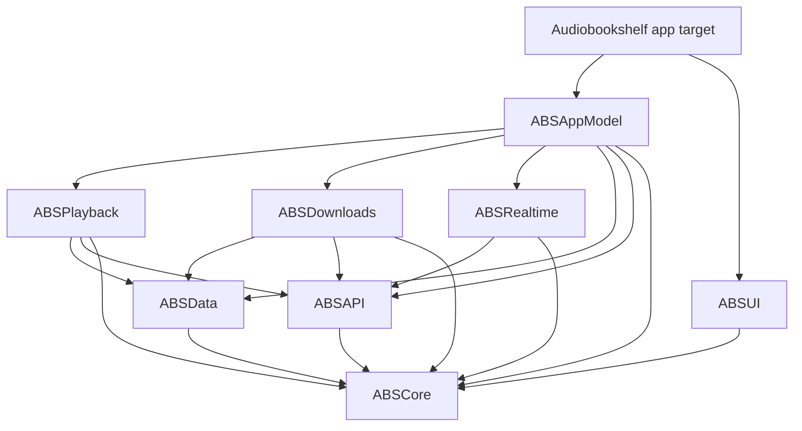

# Architecture

How the native Audiobookshelf app is put together, so that parallel contributors
make the same choices. Toolchain, commands, and Xcode project rules live in
[AGENTS.md](../AGENTS.md); this document covers code structure. The reasoning
behind it is recorded in [ADR 0001](adr/0001-architecture.md). Other decisions
are listed in the [ADR index](adr/README.md).

## Overview

- One multiplatform app target, `Audiobookshelf`, for iOS, iPadOS, and native
  macOS (not Catalyst). The CarPlay scene is part of the iOS destination.
- Almost all logic lives in the local Swift package
  [`Packages/AudiobookshelfKit`](../Packages/AudiobookshelfKit/Package.swift), split
  into modules that build and test with `swift test` (no simulator needed).
- The app target is thin: SwiftUI feature views, scene setup, the CarPlay
  templates, and the `AppEnvironment` that wires services together.
- The server holds all user progress. The app has no data migration from the
  legacy app (see [ADR 0002](adr/0002-identity-and-no-migration.md)).
- The minimum supported server is Audiobookshelf 2.26.0
  ([ADR 0007](adr/0007-streaming.md)). Version gates go through `ServerFeatures`
  in `ABSCore`; code needed only for older servers is not written.

## Modules



Arrows point from a module to the modules it may import. The app target may also
import any lower module directly when it needs a type (for example `ABSCore`
models in a view).

| Module | Owns | May import |
| --- | --- | --- |
| `ABSCore` | Shared models and value types, utilities, logging, settings, network reachability, Keychain, `ServerFeatures`, `ImagePipeline` actor and `ImageKey`, `DownloadedCoverLookup` protocol | Apple frameworks only |
| `ABSAPI` | HTTP client, authentication (local and OIDC), endpoints, custom headers, API DTOs, image request building | `ABSCore` |
| `ABSRealtime` | Socket.IO client over `URLSessionWebSocketTask` | `ABSCore`, `ABSAPI` |
| `ABSData` | SwiftData schema, `@ModelActor` stores, and `<Model>DTO` types for persisted models | `ABSCore` |
| `ABSPlayback` | Playback engine, `PlaybackCoordinator`, progress sync, sleep timer, Now Playing adapter (`ABSPlayback/NowPlaying/`) | `ABSCore`, `ABSAPI`, `ABSData` |
| `ABSDownloads` | Background `URLSession` downloads | `ABSCore`, `ABSAPI`, `ABSData` |
| `ABSUI` | Design system, shared components, covers, localized strings | `ABSCore` |
| `ABSAppModel` | Account and library state, routing (`Router`, `Route`, `DeepLink`, `AppTab` in `ABSAppModel/Navigation/`), feature view models, realtime bridge, `DownloadedCoverLookup` implementation | everything above except `ABSUI` |

Rules:

- Dependencies only point down the graph. No cycles, and no sideways imports
  between `ABSPlayback`, `ABSDownloads`, and `ABSRealtime`; coordinate them in
  `ABSAppModel`.
- `ABSUI` imports only `ABSCore`; in particular it never imports `ABSAppModel`.
  Shared components take plain values and closures, so they work in previews and
  in any feature.
- `ABSAppModel` never imports `ABSUI` and defines no views. It may import
  `Observation` and `SwiftData` (to observe stores). Prefer no SwiftUI import;
  use SwiftUI value types only if unavoidable. Navigation paths are plain
  `Codable` values (`[AppTab: [Route]]`).
- Every module is declared in `Package.swift`. Adding another target needs an ADR.
- Every new dependency edge must be declared in `Package.swift` in the same PR and
  match the table above. Changing the table needs an ADR.
- Built-in frameworks come first. Any SPM dependency must be justified in the PR;
  ZIPFoundation (for CBZ) is the only one approved so far.

## App target layout

```text
Audiobookshelf/
├── AudiobookshelfApp.swift      # @main, scenes, environment injection
├── AppEnvironment.swift         # composition root (see below)
├── CarPlay/                     # CarPlaySceneDelegate and template builders
├── Navigation/                  # RouteDestination: the one navigationDestination(for: Route.self)
├── Shell/                       # a window scene's shell: RootView, SceneRouterHost, MainTabView, PlayerSlot
└── Features/
    ├── Home/
    ├── Library/
    ├── Search/
    ├── ItemDetail/
    ├── Player/
    ├── Downloads/
    ├── Account/
    └── Settings/
```

- Each `Features/<Feature>/` folder holds the SwiftUI views for one feature, named
  `<Feature>View.swift`, plus subviews used only by that feature. Name folders after
  the user-facing feature, not the module.
- The feature's view model lives in `ABSAppModel` (in a matching `<Feature>/`
  folder) so it is tested with `swift test`. Views stay declarative: they read view
  model state and call its methods.
- A component used by two or more features moves to `ABSUI`.
- Platform differences use `#if os(iOS)` / `#if os(macOS)` inside the feature
  folder; avoid separate per-platform features. Adapt to size classes and reserved
  regions, not device type or pose (see
  [ADR 0004](adr/0004-navigation.md)).
- The folder is synchronized, so new files need no project edit.

## AppEnvironment

The app can launch with **only** the CarPlay scene connected (for example when
the phone is locked in a car), so nothing that playback or CarPlay needs may be
created by a window scene.

- `AppEnvironment` is a `@MainActor` final class in the app target, created once
  per process and reached through a static `shared` instance. It is created
  lazily on first access by `AudiobookshelfApp` or `CarPlaySceneDelegate`,
  whichever comes first.
- It is the composition root: it builds the API client, realtime client, SwiftData
  container, player, download manager, and the `ABSAppModel` state objects, and
  passes dependencies in through initializers. It contains no feature logic.
- Window scenes receive its objects through `.environment(_:)` in
  `AudiobookshelfApp`. The CarPlay scene delegate (created by UIKit, outside
  SwiftUI) reads `AppEnvironment.shared` directly.
- Both scenes drive the same player and the same account state. Any scene may
  disconnect at any time without stopping playback.
- Tests and previews never use `shared`; they build the objects they need with
  fakes.

## Concurrency

Swift 6 language mode with complete strict concurrency checking is on for every
target.

- **View models are `@MainActor @Observable` classes.** Views read them directly;
  no Combine.
- **Services are actors** (API client, realtime client, download manager, stores).
  Exceptions are types bound to the main thread by Apple frameworks (the
  `AVPlayer`-based engine, CarPlay templates); those are `@MainActor`.
- **Only `Sendable` values cross actor boundaries.** API and service types exchange
  `Sendable` structs and enums (DTOs) from `ABSCore` or the owning module: API DTOs
  in `ABSAPI`, `<Model>DTO` types for persisted models in `ABSData`.
- **No `@Model` object crosses an actor.** SwiftData access goes through
  `@ModelActor` stores in `ABSData`, which accept and return DTOs or
  `PersistentIdentifier`. Views may use `@Query` on the main context.
- **`AVAudioSession` code is wrapped in `#if os(iOS)`**; it does not exist on macOS.
  Use `#if canImport(CarPlay) && os(iOS)` for CarPlay code.
- Prefer structured concurrency (`async let`, task groups, `.task` in views) over
  detached tasks. Long-lived tasks (socket, progress sync) are owned by a service
  and cancelled when it stops.
- Do not use `@unchecked Sendable` or `nonisolated(unsafe)` without a comment
  explaining why it is safe.
- Inject time: code that waits or schedules takes a `Clock` (see below) instead of
  calling `Task.sleep` on a fixed clock.

## Testing

Use Swift Testing (`import Testing`, `@Test`, `#expect`) everywhere.

- **Where tests go.** Logic is tested in the package with `mise run test:kit`, in
  the `<Module>Tests` target of the module under test. `AudiobookshelfTests` only
  covers app-target glue, such as `AppEnvironment` wiring.
- **Fakes over mocks.** Services are used through protocols, so tests pass small
  hand-written fakes that record calls and return canned values. No mocking
  framework.
- **HTTP.** Test `ABSAPI` with a `URLProtocol` subclass registered on an ephemeral
  `URLSessionConfiguration` (`protocolClasses`), which returns canned responses and
  records requests. Never hit a real server in unit tests; the opt-in
  [server contract tests](testing/server-contracts.md) are the one exception.
- **Fixtures.** Store server JSON responses as files under the test target's
  `Fixtures/` folder and load them with `Bundle.module`. Trim real responses and
  remove personal data before committing.
- **SwiftData.** Use `ModelConfiguration(isStoredInMemoryOnly: true)` and a fresh
  container per test.
- **Time.** Types that sleep, debounce, or throttle take an `any Clock<Duration>`.
  Production passes `ContinuousClock()`; tests pass a manual clock they advance by
  hand, so tests never wait in real time.
- **Platforms.** `swift test` runs on macOS. Guard iOS-only tests with
  `#if os(iOS)`, and cover behaviour that needs a device (CarPlay, iPhone Duo) in
  the PR's manual test notes.

## Pull requests and labels

The limits are in [AGENTS.md](../AGENTS.md#pull-requests); in short:

- One issue per PR, at most 20 files and 2,000 hand-written lines (generated
  files and deletions excluded). Split larger work into more issues. The Phase 7
  legacy-removal deletions are exempt from the file limit but are split by area.
- Each issue and its PR have exactly one **type** label (`feature`, `infra`,
  `research`, or `tracking`) and one or two **area** labels (`area:core`,
  `area:api`, `area:playback`, `area:carplay`, and so on). Upstream ports also
  carry `upstream-port` (see [upstream-sync.md](upstream-sync.md)).
- Decisions that affect more than one feature, or that change this document, go in
  an [ADR](adr/README.md) first.

## Further reading

- [ADR index](adr/README.md)
- [Platform API research](research/platform-apis.md): iPhone Duo, CarPlay,
  playback, SwiftData, OIDC, String Catalogs, zip, Socket.IO.
- [Xcode project and CI research](research/xcode-project-and-ci.md): JSON project
  format, xcprojformatter, CI, Xcode Cloud.
- Legacy references for porting: `ios/App/Shared/` (player, API client, storage),
  `plugins/`, and `store/`.
